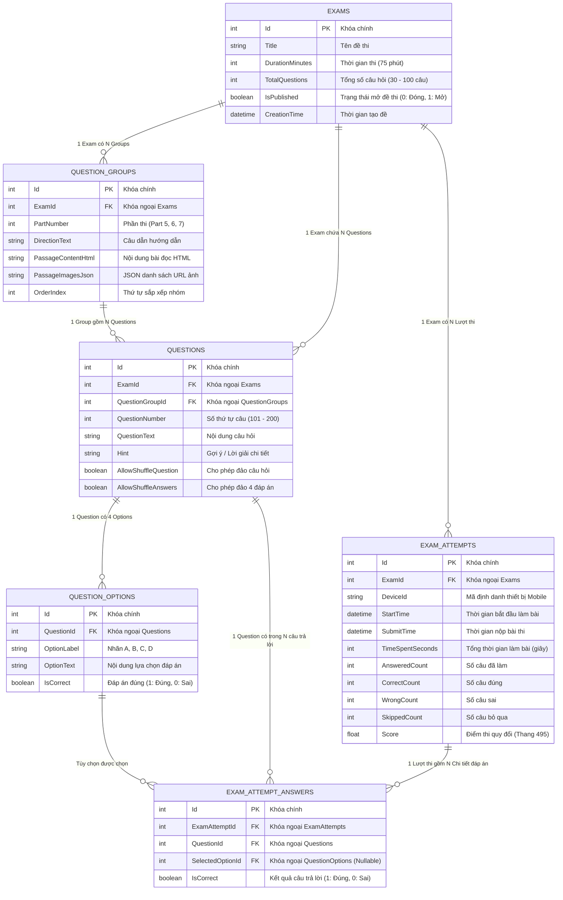

# Sơ đồ Thực thể Cơ sở dữ liệu (Database ERD)

Hệ thống thi TOEIC Reading (Level 1: Part 5 & Level 2: Part 6, Part 7)  
Cơ sở dữ liệu: **Microsoft SQL Server 2022**

---

## 1. Sơ đồ Quan hệ Thực thể (Mermaid ERD)

---

## 2. Chi tiết 6 Bảng CSDL

| Bảng | Khóa chính (PK) | Khóa ngoại (FK) | Mục đích |
| :--- | :--- | :--- | :--- |
| **`Exams`** | `Id` (int) | - | Lưu trữ thông tin đề thi, thời gian, số lượng câu hỏi và trạng thái xuất bản (`IsPublished`). |
| **`QuestionGroups`** | `Id` (int) | `ExamId` $\rightarrow$ `Exams(Id)` | Phục vụ Level 2: Nhóm đoạn văn bài đọc, câu dẫn và hình ảnh cho Part 6 và Part 7. Part 5 chứa các nhóm đơn lẻ. |
| **`Questions`** | `Id` (int) | `ExamId` $\rightarrow$ `Exams(Id)` `QuestionGroupId` $\rightarrow$ `QuestionGroups(Id)` | Lưu nội dung câu hỏi (101–200), gợi ý giải thích (`Hint`), cờ cho phép xáo trộn câu/đáp án. |
| **`QuestionOptions`** | `Id` (int) | `QuestionId` $\rightarrow$ `Questions(Id)` | 4 lựa chọn (A, B, C, D) cho từng câu hỏi cùng cờ `IsCorrect` xác định đáp án đúng. |
| **`ExamAttempts`** | `Id` (int) | `ExamId` $\rightarrow$ `Exams(Id)` | Lưu lượt làm bài của thí sinh qua mobile app (không cần đăng nhập, ghi nhận `DeviceId`, thời gian, tổng số câu đúng/sai/bỏ qua, điểm). |
| **`ExamAttemptAnswers`**| `Id` (int) | `ExamAttemptId` $\rightarrow$ `ExamAttempts(Id)` `QuestionId` $\rightarrow$ `Questions(Id)` `SelectedOptionId` $\rightarrow$ `QuestionOptions(Id)` | Ghi nhận chi tiết từng lựa chọn của thí sinh nhằm phục vụ thống kê Top 10 câu hỏi sai nhiều nhất. |

---

## 3. Mối quan hệ và Ràng buộc toàn vẹn (Integrity Constraints)

* **Level 1 (Part 5 - Câu hỏi độc lập):** Mỗi `Question` liên kết với một `QuestionGroup` không có đoạn văn bài đọc (`PassageContentHtml` = NULL).
* **Level 2 (Part 6 & 7 - Câu hỏi chùm theo bài đọc):** Một `QuestionGroup` chứa đoạn văn/hình ảnh gắn với 3–5 `Questions` thuộc chùm bài đọc đó.
* **Cascade Delete:**
  * Xóa `Exam` $\rightarrow$ Xóa toàn bộ `QuestionGroups`, `Questions`, `ExamAttempts`.
  * Xóa `QuestionGroup` $\rightarrow$ Xóa toàn bộ `Questions` bên trong nhóm.
  * Xóa `Question` $\rightarrow$ Xóa 4 `QuestionOptions`.
  * Xóa `ExamAttempt` $\rightarrow$ Xóa chi tiết các `ExamAttemptAnswers`.
